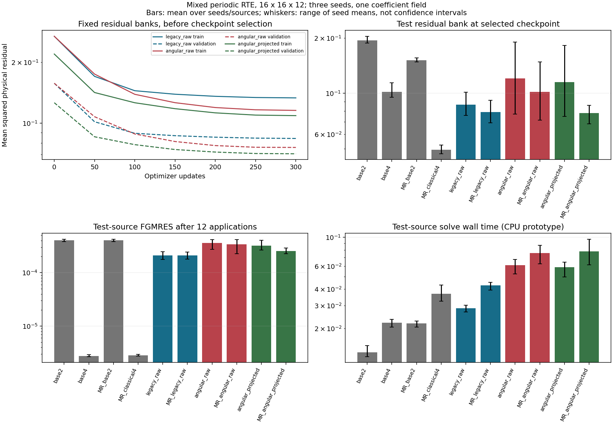

# Helmholtz / RTE: Evidence Audit And Revised Research Direction

Date: 2026-09-12. Starting revision: `389b95d`. This document supersedes the
interpretations in the conversation when they conflict with the evidence below;
it does not rewrite or discard historical numerical records. The audit combines
independent code and artifact reviews with new laptop experiments. Large CUDA
training and a replication of the Helmholtz paper were **not** performed here.

## Main conclusion

There is no evidence of a universal failure of learning for RTE. There is strong
evidence of a gap between **average one-step improvement** and **useful solver
acceleration**. The best historical full-angular U-Net improves one-step source
residual beyond TSA4, but takes about twice the recorded time to reach `1e-5`.
The new controlled experiment reproduces this mismatch even with a pure physical
loss, fixed full-bank train/validation/test metrics, and solver-based checkpoint
selection. Merely changing from a metric loss to a physical loss is not enough.

The strongest current diagnosis is that the learned correction improves the
directions emphasized by the training distribution without adequately improving
the slow directions of the iterated operator. Restricted moment architectures
add a genuine range limitation. Network overhead then makes even modest
iteration reductions insufficient. Dataset size and optimization effort remain
important controls, but are not established as the single causal bottleneck.

## Project map and conversation decisions

- `helmholtz/`: original pseudo-spectral CBS/NPBS; preserve its physical scaling
  and padded absorbing-boundary treatment. The FD shifted-Laplacian comparisons
  are separate discretization experiments, not identical discrete systems.
- `helmholtz/local_revisions/`: local CBS/SL comparison runners and reports.
- `rte/models.py`: periodic discrete-ordinates transport, Born, DSA-style and
  TSA-style reference corrections. No ATFPS discretization is used here.
- `rte/npbs_unet_ablation.py`: historical learned architectures and shared
  training/evaluation utilities. Historical architecture names remain valid.
- `rte/npbs_bottleneck_harness.py`: objective/checkpoint ablations.
- `rte/run_large_angular_spectral_experiments.py`: repaired coefficient-ensemble
  runner, distinct from historical fixed-medium residual-bank trials.
- `rte/residual_subspace.py`: new residual-minimizing correction wrapper.
- `rte/run_residual_subspace_experiment.py`: controlled laptop comparison and
  difficult-residual replay arm.
- `rte/archive/ARTIFACT_INDEX.md`: grouped inventory of existing research files.
- `docs/research/historical_evidence.tsv`: 15 selected historical CSVs, 184 rows,
  360 checked traces, exact source digits, locations and hashes. This is a
  targeted evidentiary selection, not a claim that every old run was reproduced.

Only 21 unreferenced scratch artifacts were moved into `rte/archive/smoke`.
The move manifest preserves SHA-256 hashes; 11 referenced candidates stayed in
place. Numerical data, referenced reports, and source code were not deleted.
Ignoring checkpoints in Git is not equivalent to having a reproducible trained
model: many historical `.pt` banks and weights are unavailable in this checkout.

## What was actually wrong in the code

| Finding | Consequence | Repair and boundary |
|---|---|---|
| Regime subset used local IDs to index a global stack | `--regimes mixed` selected diffusive coefficients | Map to global IDs; verify all subsets. Does not invalidate old `make_case` trials. |
| CSV fieldnames came from the first row | Training-only and evaluation rows caused a write error | Union schema; test `eval_every=2`, not only 1. |
| Epochs meant two random updates | 2,000 nominal epochs on 4,096 samples meant only 62.5 sample passes | Full shuffled passes by default; log updates, presentations, effective passes. |
| Incomplete resume/selection provenance | Continued optimization was not an exact restart | Separate `last.pt` and `best.pt`, RNG and scheduler state, step-zero fallback, strict horizon/runtime/cache checks. |
| Silent unavailable-CUDA fallback | A requested GPU run could execute on CPU | Fail explicitly; save actual hardware/software configuration. |
| Grouped decoder concatenated all skips before all upsampled modes | Grouped convolutions consumed channels from the wrong modes | Concatenate within each mode, then flatten. Regression tests isolate angular groups. |
| Low-rank factors were unconstrained | Bounded coefficients did not bound the mixing operator | Normalize factors and average over rank; bound the perturbation, not the full U-Net. |
| Left/right factors could share storage | A nominally independent factor could change with the other | Clone parameter storage; test independence. |
| Every setup built a full angular inverse | DSA training paid for an unused dense inverse at every Fourier node | Lazy full-TSA cache, invalidated on coefficient setup; DSA and batched TSA identities checked. |
| Source phase also controlled material channel phase | Artificial source/material correlation in the ensemble | Independent material phase; dataset schema version 3 invalidates old caches. |

The decoder and low-rank repairs affect the newer angular-spectral class. They
cannot explain failures of the earlier legacy U-Net or CoeffWeighted models.
Old nonzero angular-spectral checkpoints need re-evaluation after these semantic
changes; matching parameter shapes do not imply unchanged predictions.

## Mathematical objects and terminology

The benchmark is on the spatial torus `[0,1)^2`, with `N x N` points,
`dx=1/N`, directions `Omega_l=(cos(2*pi*l/L),sin(2*pi*l/L))` on the circle,
and uniform weights `w_l=1/L`. Angular space is **S1, not physical S2**.
Streaming uses spatial Fourier multipliers `i*k.Omega_l`, where
`k=2*pi*fftfreq(N,d=dx)`. The system is

\[
 A_h\psi=\Omega\cdot\nabla_h\psi+\sigma_t\psi-\sigma_s P_h\psi=q.
\]

`P_h` is the row-normalized circular Poisson-kernel phase matrix, with parameter
`|g|<1`; it is isotropic when `g=0`. The norm is
`||v||_h^2=dx^2/L * sum |v_lij|^2`. Constant quadrature factors cancel in
relative residuals, so the code's Euclidean ratio is equivalent on this grid.
This does not license omitting `dx` from the streaming operator.

Write `G=(Omega.grad_h + sigma_ref + eta)^(-1)`, with spatial mean
`sigma_ref=mean(sigma_t)` and
`eta=1e-6 + eta_scale*max(|sigma_t-sigma_ref|+sigma_s)`.
The Born identity `I-GV=GA`, `V=G^(-1)-A`, is an algebraic identity, **not** a
contraction theorem for an arbitrary learned map.

The base correction `B_h` is selected explicitly:

- **Born/transport:** `B r=G r`.
- **DSA-style:** `B r=G r + lift(D_ref^(-1) moment(r-A G r))`, where
  `D_ref=-d_ref*Delta_h+mean(sigma_t-sigma_s)` and `d_ref=1/(2*sigma_ref)`.
  This is a constant-reference periodic scalar diffusion augmentation. It is
  not heterogeneous transport-consistent DSA and does not use the anisotropic
  transport cross section in `d_ref`.
- **TSA-full:** replace the scalar diffusion correction by the complete angular
  reference inverse with Fourier matrix
  `diag(i*k.Omega_l+sigma_ref+eta)-mean(sigma_s)*P_h`.
- **TSA-M4:** use the closed reference inverse projected onto angular Fourier
  modes `0,+/-1,...,+/-4`. This is nine retained modes, **not four iterations**.
- **TSA4/DSA4:** four successive defect-correction applications of the stated
  base, starting from zero: `C_4(r)=sum_{j=0}^3 B(I-AB)^j r` for a fixed linear
  unit-relaxation base. TSA2 and DSA2 mean two such applications.

The legacy defect2 model is `M(r)=z0+omega*z1+delta_theta(z0,z1;a)`,
`z0=B r`, `z1=B(r-A z0)`. Here `a` denotes coefficient features, not an angular
mode index. Zero output and `omega=1` recover `C_2` exactly. Its coefficient
encoder is nonlinear in the medium, while its bias-free gated U-Net is
real-linear in residual real/imaginary channels for fixed coefficients and
without the optional residual-dependent heads. Complex-linearity is not assumed.
The new angular class preserves **all L angular modes**, groups spatial
convolutions per mode, mixes modes at each scale, and adds coefficient-dependent
low-rank mixing and residual-energy gates. It is generally nonlinear in `r`.

All new Krylov experiments use **real-stacked FGMRES**, treating a complex vector
as its concatenated real/imaginary parts. This accommodates these real-linear
and nonlinear corrections without pretending they are complex-linear.

## Explicit losses and why decreasing loss is insufficient

For one residual, define `e=r-A M(r)`,
`rho_phys=||e||/||r||`, and `rho_B=||B e||/||B r||`.
The physical objective is `L_phys=mean(rho_phys^2)` over the stated residual
bank. `mean(rho_phys)`, `sqrt(L_phys)`, and `rho_phys(q)` on a single source
are different statistics. In particular, `mean(rho)^2 <= mean(rho^2)`.
The metric objective uses `mean(rho_B^2)`, not `L_phys`.

Historical objectives can additionally contain a correction-size penalty,
per-step rollout ratios normalized by the **current** residual, a stability
hinge, or teacher discrepancy. Correction-teacher loss
`||M(r)-C_4(r)||^2/||C_4(r)||^2` differs from action-teacher loss
`||A(M(r)-C_4(r))||^2/||r||^2`. The repaired ensemble runner's `solver_teacher`
uses the latter. Its fixed-probe evaluations use full teacher weight even
during the training ramp, so they are not the same statistic as epoch losses.

For a fixed real-linear `M`, real-stack the vectors and let `E=I-AM`. Then

\[
 L_{\rm phys}=\operatorname{tr}(E C E^T),\qquad
 C=\mathbb E\left[rr^T/\|r\|^2\right].
\]

Here `C` is the uncentered second moment of normalized, Euclidean real-stacked
residuals, often abbreviated as covariance in this discussion. On its range,
`||E P_range(C)||_2^2 <= L_phys/lambda_min_positive(C)`; the loss alone imposes
no restriction on `ker(C)`. Architecture-induced generalization remains possible.

This identity proves that small average loss weights directions according to
`C`; it does not control the worst direction if `C` has small or zero
eigenvalues. The original empirical 64-vector bank lives in real dimension 6,144 and
has covariance rank at most 64. For isotropic normalized probes, the objective
is `||E||_F^2/6144`, still not the spectral norm. Nonlinear models require a
distributional analysis instead of a single error matrix.

Stationary convergence depends on powers of `E`. Krylov convergence depends on
the sequence of generated spaces and operator actions, not just the first
defect. Streaming and scattering/heterogeneity do not generally commute, so
normal-matrix eigenvalue intuition is insufficient. These are mathematical
mechanisms, not a proof that every observed poor solve has the same cause.

`CoeffWeightedTSA-M4` changes spatial weights within a fixed angular range.
The existing learned R/P moment class also left- and right-multiplies **within
that same retained range**, surrounding a fixed reference inverse. It does not
learn a new fine-space range or recompute a Galerkin coarse operator. Making
those matrices wider or nonlinear cannot create missing angular components.
A true learned coarse space must permit columns outside that range and define
an appropriate `R_theta A P_theta` solve. Such a space is a candidate, not yet
an empirically established cure. Full-angular U-Nets do not need R/P merely to
retain angular information.

## Historical evidence, reinterpreted

The extractor records source/trace hashes and first crossings of common
tolerances. The full12 legacy comparison uses size 64, 12 angles, one fixed
mixed medium, 5,949 residual-bank entries, width 16, four U-Net levels,
batch 256, physical plus correction-teacher loss, and full TSA. These are not
5,949 different media. Endpoint training losses can use different minibatches.

| Record | Sampled train ratio, initial to final | Sampled objective, initial to final | Heldout-source one step | FGMRES first `1e-5`: iterations / seconds |
|---|---:|---:|---:|---:|
| XL14400 U-Net | .319635 -> .210184 | .293390 -> .095186 | .111631 | 15 / .214852 |
| XL14400 TSA4 | n/a | n/a | .114459 | 11 / .105348 |
| Final continuation U-Net | .203807 -> .208731 | .087248 -> .096855 | .107681 | 15 / .202553 |
| Final continuation TSA4 | n/a | n/a | .114459 | 11 / .101581 |

The continuation's endpoint increase is **not a fixed-bank loss curve**.
Its lower heldout-source one-step ratio is real, but no wall-time win follows.
The final learned method uses 30 base applications to first reach `1e-5`,
versus TSA4's 44, yet costs about twice as much. Thus equal base-call counts
are only a partial work proxy. Count network work, operator evaluations,
orthogonalization, setup, precision, and training amortization too.

At 40 total Krylov iterations these records do not reach `1e-6`. Their
`7e-6` to `8e-6` tails are consistent with a precision limitation but do not
prove it: there is no saved stop-reason flag or matching higher-precision
rerun. Do not rank preconditioners by tiny differences at this tail. First
crossings are trace observations, not reruns stopped at the new tolerance.

Pure physical moment-loss and width-64 controls **do exist** in the updated
repository. They were absent at an earlier stage of the conversation. They
do not establish a substantial solver benefit for CoeffWeighted-M4; learned
moment mixing/RP can improve a source's first correction while worsening its
Krylov behavior. An old statement that physical loss was never tried is stale.

## New controlled laptop experiment

Command: `python -m rte.run_residual_subspace_experiment --steps 300 --eval-every 50 --seeds 1 2 3`.
The coefficient field is `make_case('mixed')`: thin/thick attenuation .35/16
plus a Gaussian interface layer, albedo .20/.985, `g=.65`, `eta_scale=.1`.
Use size 16, 12 angles, complex64/float32, full TSA, width 16, three levels;
the angular model has four hidden channels per angular mode. There are 71,872
legacy parameters versus 131,499 angular parameters, not matched parameter
counts. The optimizer is
AdamW (`lr=.001`, weight decay `.0001`), cosine schedule to 1% of initial LR,
gradient norm clip 1, batch 16, 300 updates. CPU, one PyTorch thread, Torch 2.8.0.

Per seed: eight training sources, two validation sources, three test sources;
centers are independently sampled, angular profiles cycle beam/dipole/isotropic.
Six classical residual states per source plus 16 smooth random-action probes
give banks of 64/28/34 normalized vectors. Source/initialization seeds vary;
the medium does not. Random-probe fractions consequently differ: 25%, 57.1%
and 47.1%. The two validation sources omit the isotropic profile. Comparing
methods within each split is valid, but cross-split loss gaps alone do not
diagnose overfitting. Checkpoint selection uses mean validation-source FGMRES
at step 0 and every 50 updates. Test sources never select a checkpoint.
Solver budget: 12 applications, tolerance `1e-6`; all actual A/base calls are
counted, including residual-minimization checks. Timings exclude training and
coefficient setup, include solver work, and follow a warmup. They are small CPU
observations, not stable GPU throughput estimates or matched-tolerance timings.

| Selected method | Train physical loss | Validation physical loss | Test physical loss | Test-source one step | FGMRES residual | Seconds |
|---|---:|---:|---:|---:|---:|---:|
| TSA2 | .26809 | .15730 | .19370 | .26191 | 4.0651e-4 | .01309 |
| TSA4 | .14667 | .08896 | .10171 | .15842 | 2.7625e-6 | .02209 |
| Legacy raw U-Net | .13446 | .08474 | .08675 | .20980 | 2.0957e-4 | .02849 |
| Angular raw U-Net | .17425 | .09611 | .12070 | .23563 | 3.6112e-4 | .06105 |
| Residual-minimized legacy | .12507 | .07781 | .07902 | .20652 | 2.0965e-4 | .04283 |
| Projected-trained angular, deployed with minimization | .12192 | .07322 | .07809 | .21389 | 2.5413e-4 | .07796 |
| Residual-minimized classical four-stage | .07523 | .04295 | .04941 | .15102 | 2.8452e-6 | .03689 |

These are means over three seeds; source metrics average three test sources per
seed. No independent-medium confidence interval is claimed. Full rows and
seed ranges are in `rte/results/residual_subspace_mixed`. In particular:

1. Legacy has lower test-bank loss than TSA4 but a roughly 76x larger FGMRES
   residual and higher time. The mismatch is not just a metric-loss artifact.
2. Angular raw seed 3 trains from `.2648` to `.1031`, while validation FGMRES
   worsens from `5.029e-4` to `6.376e-4`; selection correctly keeps step zero.
3. Projection is also given to classical controls. It improves their one-step
   bank loss more than the learned competitors. A favorable projected result
   cannot be credited entirely to the neural architecture.
4. Scalar rescaling of TSA2 leaves its exact-arithmetic FGMRES search space
   unchanged when the scales are nonzero. Its nearly unchanged numerical
   residual is expected; a better scalar one-step step is not a better space.

The tracked vector figure is `comparison.pdf` beside the CSVs.

The test-bank decomposition makes the source of the average-loss gain explicit:

| Residual subset | TSA4 physical loss | Legacy physical loss |
|---|---:|---:|
| Source stage zero | .02612821 | .04872599 |
| All six classical trajectory stages | .19201436 | .16256699 |
| Smooth-solution action probes | .00011318 | .00145119 |
| Entire test bank | .10170792 | .08674779 |

The benefit is concentrated in later classical-rollout residuals, **not in the
source or random-probe subsets**. Normalizing every vector gives late, small
residuals the same sample weight as large early ones. At 24 base calls the
legacy method's 12 FGMRES iterations actually beat six TSA4 iterations
(`2.095741e-4` versus `8.303324e-4`). The observed efficiency failure is the
combination of neural overhead and an inadequate gain at equal wall time,
not a claim that learned directions never improve an equal-base-work solve.
The supplementary script `python -B -m rte.analyze_residual_bank --check`
reconstructs bank components, evaluates all controls on the **same** learned
witness, and checks the equal-base-budget comparison. Its CSVs are preserved
beside the original results; largest reconstructed bank discrepancy is `2.465e-8`.

### Witnesses for the missed slow directions

`python -m rte.probe_residual_amplification` applies 30 power iterations to
`E^T E` for the real-linear legacy map and fixed classical controls, then
measures actual residual ratios. This is a witnessed **lower bound**, not a
certified norm, and values below one do not prove uniform contraction.

- TSA2 witnessed one-step ratios: `.8998` to `.9021`.
- Trained legacy: `.8967` to `.9062`, essentially unchanged.
- TSA4: `.7772` to `.7785`.
- After 12 stationary applications to each method's witness, legacy retains
  `.1826` to `.1870` of its norm, versus `.0337` to `.0340` for TSA4.
- Legacy witnesses have 17.5% to 19.0% angular energy outside M4 and 23.2% to
  54.6% spatial Fourier energy outside the `|kx|,|ky|<=5` probe cutoff.

These witnesses support a missed-direction bottleneck. They do not establish
which architecture or data intervention can fix it. Smooth probe solutions
are filtered, but `A(probe)` can acquire higher frequencies through variable
coefficients, so the training residual bank is not strictly band-limited.

## Implemented safeguard and training repair

The network proposes `delta`; it does not dictate its deployment coefficient.
Given `b=C_2(r)` and `Q=[delta,b]`, solve a two-variable real ridge problem

\[
 c=\arg\min_c\|r-A(b+\widetilde Qc)\|^2+\lambda\|c\|^2,
 \quad\lambda=10^{-6},
\]

where each column is normalized by its detached action norm. The small Gram
system is accumulated in float64; corrections remain in the model dtype.
Explicit true-residual checks select among zero, `b`, the fitted candidate,
and `b+q_j`. This guarantees no worse **individual** finite one-step residual
than the included classical or native learned candidate. It does not prove a
strict contraction or dominance over the classical solver's future path.
Rank-deficient and zero columns, independent least-squares comparison, and
autograd are tested. No exact solution labels are needed.

Projected training uses forward loss `L_phys(projected)+.25*L_phys(native)`.
Detached action normalization produces a **surrogate gradient**, not the exact
gradient of this displayed forward objective when the ridge is positive.
The native term can supply a nonzero first derivative at zero learned output, where a
pure subspace-fit objective may stall. The additional A evaluations are charged;
the present wrapper is not faster than plain TSA4 and is not the new default
solver. Its measured benefit is one-step safeguarding.
The native derivative can also vanish, for example through tangent-space
orthogonality or an already exact baseline; the nonzero-gradient tests cover
their fixtures, not all networks and problems.

A separate `legacy_replay` arm keeps the legacy architecture and pure physical
loss, but replaces one quarter of each minibatch with four detached difficult
residuals found by 15 power iterations every 50 updates. It uses training
coefficients/model only, not validation/test sources. Sampling changes and
extra probe work are explicit; equal optimizer updates are not equal training
time. Its results are an exploratory follow-up to the witnesses, not an
independently pre-registered confirmation.

The completed three-seed replay run has mean test-bank loss `.08754` versus
`.08675` for the identical raw-loss legacy control; test-source FGMRES is
`2.1880e-4` versus `2.0957e-4`. Its searched one-step ratios improve to
`.8821`--`.8844`, but 12 stationary steps still retain `.1845`--`.1868`.
The local witness objective moved without a useful repeated-solver gain.
This rejects the sufficiency of this **small replay intervention**, not every
replay scheme or a general capacity claim. See `rte/results/residual_replay_mixed`.

## Next experiments and decision rules

1. **Learn the missing correction directions, not just a damping scalar.**
   Compare raw-loss legacy with difficult-residual replay and actual FGMRES
   residual/basis replay at fixed architecture, updates, and bank size. Record
   worst witnessed residuals as well as fixed-bank average loss. Reject a
   sampling scheme that only improves its own probe distribution.
2. **Match the objective to the generated space.** Test short differentiable
   real-FGMRES losses or retain multiple learned directions in an augmented
   Krylov solve. Action-teacher targets are preferable to correction norms
   when compressing TSA4. Compare against classical directions with the same
   augmentation and charge every A evaluation. This is proposed, not proved.
3. **Only then test new spaces.** Preserve full angular information on fine
   levels. Learn columns beyond a fixed M4 range, with rank/conditioning checks
   and an A-aware small solve. Do not call a rotation inside M4 a new subspace.
   Peng's ROM-enhanced FGMRES uses reduced correction spaces inside a Krylov
   method and supplies a useful comparison, not a direct validation of this
   network. Its discretization and problem family differ from this benchmark.
   [Primary paper](https://arxiv.org/html/2410.08735v3).
4. **Separate data and effort.** Use the repaired ensemble plan with nested
   256/4096-medium datasets and matched 128,000 updates, then matched model and
   objective controls. The large arms use 2,000 full passes; the small arm uses
   32,000. These are expensive exploratory coefficient-generalization studies,
   not a substitute for fitting a difficult fixed medium. Use several seeds.
   These arms enlarge a joint medium/source pool: one source is stored per
   medium, so coefficient and source diversity are not separately identified.
   Crossed medium/source counts and different effort budgets remain needed.
   The raw versus teacher arm removes both rollout and teacher penalties;
   add raw-plus-rollout to identify the teacher's marginal effect. A pilot's
   test set becomes exploratory after its results guide changes; use fresh
   confirmatory test cases afterward.
5. **Acceptance criterion:** better time to a common true-residual tolerance on
   untouched sources/media, at fixed precision, including failure rates and
   setup/training amortization. Low one-step loss, fewer base calls, a selected
   checkpoint, or a passing unit test alone does not satisfy this criterion.

## Verification and remaining limits

RTE Born/reference identities and moderate-scattering solvers passed the
float64 verifier. Helmholtz CBS identities passed at size 16 without changing
its discretization. Dedicated tests cover channel layout, factor bounds,
batched values/gradients, checkpoint replay, cache validation, loss statistics,
and the residual-minimizing layer. The historical extractor checks source
summary/trace agreement and preserves missing evidence explicitly.
The final unit-test runs have **49 passes and one CUDA skip** across `rte/tests`
and the artifact-organizer suite. The seven-page mathematical note compiles
without unresolved references or box warnings and its rendered pages were
visually checked. Passing these checks is not a learned-convergence theorem.

No CUDA run, full-medium generalization claim, production boundary treatment,
uniform learned-contraction theorem, or complete-paper replication is claimed.
The new runner is tested infrastructure; the thousand-pass experiments have
not been run. See `rte/LARGE_ANGULAR_SPECTRAL_EXPERIMENT_PLAN.md` for commands.
