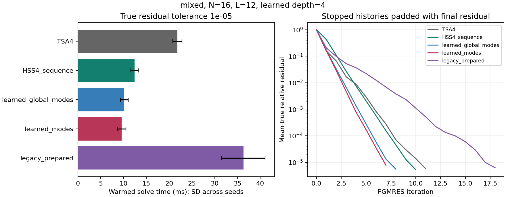
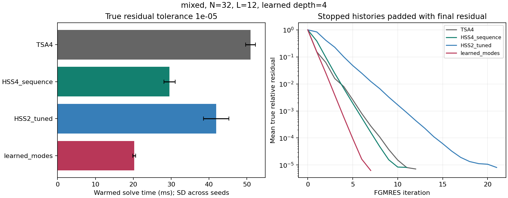
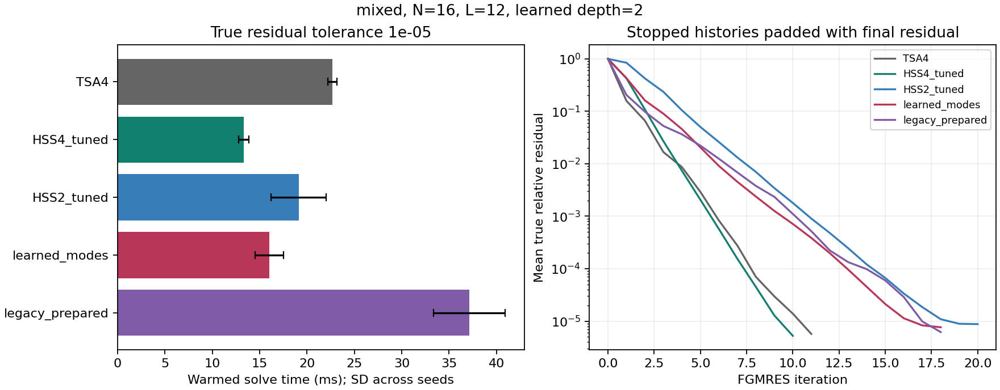
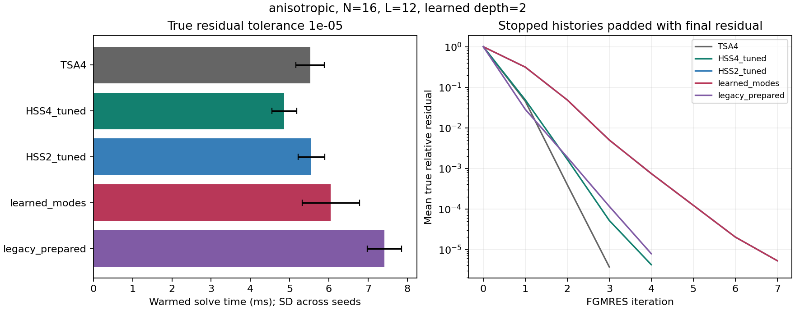

# Collision/Transport Numerical Results

Generated by `scripts/summarize_collision_transport.py`; no values are transcribed by hand.

All losses are **mean squared relative physical residuals**. RMS is sqrt(loss), not the mean ratio. Train/validation/test losses describe the validation-selected checkpoint, not necessarily the last update. Iteration and solve-time summaries first average the three sources within each seed, then average seeds. The reported time variation is sample SD across seed means; it is not a confidence interval. Time excludes training and shared operator construction; each source time is the median of repeated warmed solves.

## mixed, N=16, L=12, learned depth=4

Data: `rte/results/collision_transport_mixed_final`. Seeds: 1, 2, 3. Updates: 300; batch: 16; tolerance: 1e-05; maximum iterations: 30.

| Method | Train loss | Validation loss | Test loss | Source one-step ratio | Iters | Solve ms (SD) | Converged |
|---|---:|---:|---:|---:|---:|---:|---:|
| TSA2 | 0.180482 | 0.188317 | 0.195349 | 0.261907 | 18.6667 | 23.239 (1.233) | 9/9 |
| TSA4 | 0.0887479 | 0.0961796 | 0.0930445 | 0.158424 | 10.6667 | 21.841 (1.011) | 9/9 |
| HSS2_tuned | 1.15575 | 1.15487 | 1.26698 | 1.30258 | 18.6667 | 16.536 (1.084) | 9/9 |
| HSS4_tuned | 0.189515 | 0.188399 | 0.196136 | 0.4497 | 9.88889 | 13.366 (0.646) | 9/9 |
| HSS2_sequence | 1.15575 | 1.15487 | 1.26698 | 1.30258 | 18.6667 | 17.618 (0.532) | 9/9 |
| HSS4_sequence | 0.189515 | 0.188399 | 0.196136 | 0.4497 | 9.88889 | 12.420 (0.810) | 9/9 |
| learned_shifts | 0.189515 | 0.188399 | 0.196136 | 0.4497 | 9.88889 | 12.807 (1.295) | 9/9 |
| learned_global_modes | 0.0283335 | 0.0284988 | 0.0304959 | 0.170966 | 7.77778 | 10.176 (0.860) | 9/9 |
| learned_modes | 0.0165928 | 0.0171175 | 0.0194277 | 0.16046 | 7 | 9.596 (0.959) | 9/9 |
| legacy_raw | 0.095262 | 0.098409 | 0.0928585 | 0.20713 | 17.4444 | 50.174 (0.427) | 9/9 |
| legacy_prepared | 0.095262 | 0.098409 | 0.0928585 | 0.20713 | 17.4444 | 36.310 (4.764) | 9/9 |

### Training And Selection

| Method | Parameters | Initial train loss | Last train loss | Last validation loss | Selected steps | Train+validation seconds/seed |
|---|---:|---:|---:|---:|---|---:|
| learned_shifts | 160 | 0.189515 | 0.0437795 | 0.0403585 | 0, 0, 0 | 6.787 |
| learned_global_modes | 1340 | 0.189515 | 0.0224957 | 0.0231413 | 50, 200, 200 | 7.083 |
| learned_modes | 1340 | 0.189515 | 0.0161107 | 0.0166058 | 150, 250, 150 | 10.301 |
| legacy_raw | 71872 | 0.180482 | 0.0857917 | 0.0877306 | 150, 100, 200 | 18.200 |

### Artifact Hashes

- `results.csv`: `daa49b3ce31d98bd79aa0e4daacbfa652c00915185b8e0ea1135d882ef3f8ded`
- `bank_groups.csv`: `5e012316ff85017fe2fd7e6c72cd4161f4030ffaf2e0110b47aaed09cd6f0774`
- `classical_tuning.csv`: `90624979f8a84c0531fa109091ee0f8485b9a04813edfac87507f792fc57a58c`
- `convergence.csv`: `65ced36113c9eb868259f6c5d84393b94a963a0c61c5df350eb983f84eb144a5`
- `settings.json`: `d3ac494297a191311317581916422f92b4af3c6ff3c69cbf09ff7264678706fc`

## mixed, N=32, L=12, learned depth=4

Data: `rte/results/collision_transport_mixed_size32_controls`. Seeds: 1, 2, 3. Updates: 300; batch: 16; tolerance: 1e-05; maximum iterations: 30.

| Method | Train loss | Validation loss | Test loss | Source one-step ratio | Iters | Solve ms (SD) | Converged |
|---|---:|---:|---:|---:|---:|---:|---:|
| TSA2 | 0.176086 | 0.184157 | 0.190264 | 0.257665 | 19.3333 | 55.524 (3.544) | 9/9 |
| TSA4 | 0.0859169 | 0.0924951 | 0.0887285 | 0.153913 | 11.1111 | 50.943 (1.300) | 9/9 |
| HSS2_tuned | 1.0899 | 1.10469 | 1.21817 | 1.28558 | 20.2222 | 41.890 (3.363) | 9/9 |
| HSS4_tuned | 0.177162 | 0.177868 | 0.185127 | 0.434995 | 10 | 34.681 (11.926) | 9/9 |
| HSS2_sequence | 1.0899 | 1.10469 | 1.21817 | 1.28558 | 20.2222 | 40.314 (1.051) | 9/9 |
| HSS4_sequence | 0.155122 | 0.155051 | 0.159405 | 0.408542 | 10.2222 | 29.580 (1.467) | 9/9 |
| learned_modes | 0.0154425 | 0.0166595 | 0.0182112 | 0.15419 | 7 | 20.240 (0.411) | 9/9 |

### Training And Selection

| Method | Parameters | Initial train loss | Last train loss | Last validation loss | Selected steps | Train+validation seconds/seed |
|---|---:|---:|---:|---:|---|---:|
| learned_modes | 1340 | 0.177162 | 0.0153463 | 0.0165332 | 200, 250, 300 | 23.846 |

### Artifact Hashes

- `results.csv`: `a7733ac7cfea27abee502ed71400a58bfa5cf203e9e790acebc3db41dc070f7a`
- `bank_groups.csv`: `be007a29657f583642e5474c278a773d8c6311bdd2bcbef8cc651c5c9770c938`
- `classical_tuning.csv`: `eca35bd1d35559ebc57e1b4c0b6605cabd2f09ec0d1452c0611ede297cad5608`
- `convergence.csv`: `48a09137521fd1d66bb2d349424da349f9f8e7633aaad1f65de5016b289e432a`
- `settings.json`: `08a2bc28d3ded60fb7aeb7ff9073f872a573566a37986d8a5cbf1211fe39c48e`

## mixed, N=16, L=12, learned depth=2

Data: `rte/results/collision_transport_mixed_controls`. Seeds: 1, 2, 3. Updates: 300; batch: 16; tolerance: 1e-05; maximum iterations: 30.

| Method | Train loss | Validation loss | Test loss | Source one-step ratio | Iters | Solve ms (SD) | Converged |
|---|---:|---:|---:|---:|---:|---:|---:|
| TSA2 | 0.180482 | 0.188317 | 0.195349 | 0.261907 | 18.6667 | 27.493 (4.995) | 9/9 |
| TSA4 | 0.0887479 | 0.0961796 | 0.0930445 | 0.158424 | 10.6667 | 22.698 (0.478) | 9/9 |
| HSS2_tuned | 1.15575 | 1.15487 | 1.26698 | 1.30258 | 18.6667 | 19.118 (2.917) | 9/9 |
| HSS4_tuned | 0.189515 | 0.188399 | 0.196136 | 0.4497 | 9.88889 | 13.331 (0.526) | 9/9 |
| HSS2_sequence | 1.15575 | 1.15487 | 1.26698 | 1.30258 | 18.6667 | 18.413 (1.755) | 9/9 |
| HSS2_macro1 | 1.31335 | 1.28336 | 1.39926 | 1.32759 | 30 | 37.453 (2.460) | 0/9 |
| learned_shifts | 1.15575 | 1.15487 | 1.26698 | 1.30258 | 18.6667 | 19.131 (1.561) | 9/9 |
| learned_modes | 0.197622 | 0.210729 | 0.21445 | 0.450941 | 16.5556 | 16.025 (1.490) | 9/9 |
| legacy_raw | 0.095262 | 0.098409 | 0.0928585 | 0.20713 | 17.4444 | 56.074 (9.473) | 9/9 |
| legacy_prepared | 0.095262 | 0.098409 | 0.0928585 | 0.20713 | 17.4444 | 37.121 (3.780) | 9/9 |

### Training And Selection

| Method | Parameters | Initial train loss | Last train loss | Last validation loss | Selected steps | Train+validation seconds/seed |
|---|---:|---:|---:|---:|---|---:|
| learned_shifts | 134 | 1.15575 | 0.323941 | 0.332237 | 0, 0, 0 | 4.468 |
| learned_modes | 1132 | 1.15575 | 0.194907 | 0.20812 | 100, 200, 100 | 4.050 |
| legacy_raw | 71872 | 0.180482 | 0.0857917 | 0.0877306 | 150, 100, 200 | 17.176 |

### Artifact Hashes

- `results.csv`: `5ba7aa336b5c414aa6902c9ed93a3f54123d34793ee1874560410310de9a8a96`
- `bank_groups.csv`: `2bbb9c54638e50f06b73931cfbdd474dcda4c0b03e84206052e1bd650fe74e6a`
- `classical_tuning.csv`: `a2d832d339d911ce3df11b4748d0d0c390d06e6ae341c81db960c9a3741e3f00`
- `convergence.csv`: `f0f4326fe3ad891e0836ea53e1882a0663f7fc498b5dc156a46055ed16a05930`
- `settings.json`: `88c464860d7be57022f4d0c29257dbe87c8b04f0c3578022fa4962bd5c6751f0`

## anisotropic, N=16, L=12, learned depth=2

Data: `rte/results/collision_transport_anisotropic`. Seeds: 1, 2, 3. Updates: 300; batch: 16; tolerance: 1e-05; maximum iterations: 30.

| Method | Train loss | Validation loss | Test loss | Source one-step ratio | Iters | Solve ms (SD) | Converged |
|---|---:|---:|---:|---:|---:|---:|---:|
| TSA2 | 0.0957654 | 0.0958003 | 0.0958013 | 0.101433 | 4.66667 | 5.059 (0.046) | 9/9 |
| TSA4 | 0.0204233 | 0.0204307 | 0.0204309 | 0.0459874 | 3 | 5.523 (0.368) | 9/9 |
| HSS2_tuned | 0.0585097 | 0.0585389 | 0.0584503 | 0.314619 | 7 | 5.554 (0.338) | 9/9 |
| HSS4_tuned | 0.00289775 | 0.00289791 | 0.00289038 | 0.0507831 | 4 | 4.865 (0.316) | 9/9 |
| HSS2_sequence | 0.071327 | 0.0713182 | 0.07128 | 0.236194 | 6.66667 | 5.384 (0.500) | 9/9 |
| HSS2_macro1 | 0.0321109 | 0.0322213 | 0.0318985 | 0.310264 | 7 | 7.381 (0.492) | 9/9 |
| learned_shifts | 0.0254404 | 0.0254368 | 0.0254116 | 0.28041 | 7 | 6.450 (1.234) | 9/9 |
| learned_modes | 0.0585097 | 0.0585389 | 0.0584503 | 0.314619 | 7 | 6.051 (0.735) | 9/9 |
| legacy_raw | 0.000443044 | 0.000447668 | 0.000448217 | 0.028656 | 4 | 10.000 (0.162) | 9/9 |
| legacy_prepared | 0.000443044 | 0.000447668 | 0.000448217 | 0.028656 | 4 | 7.414 (0.439) | 9/9 |

### Training And Selection

| Method | Parameters | Initial train loss | Last train loss | Last validation loss | Selected steps | Train+validation seconds/seed |
|---|---:|---:|---:|---:|---|---:|
| learned_shifts | 134 | 0.0585097 | 0.0250849 | 0.0250779 | 50, 50, 150 | 3.476 |
| learned_modes | 1132 | 0.0585097 | 0.0192364 | 0.019204 | 0, 0, 0 | 4.141 |
| legacy_raw | 71872 | 0.0957654 | 0.000434073 | 0.000438894 | 250, 250, 300 | 16.483 |

### Artifact Hashes

- `results.csv`: `7a6838d2be8ea2e8decea79c4259469e3c4e8ea53ce4843d9e7ac2ad078a6639`
- `bank_groups.csv`: `30ac0650d3cedb59057a712a02018233e328f89f0afaa10d0033591825c0cd93`
- `classical_tuning.csv`: `0cff0b6fe2357b975282adf1e3b9312f352ec99dc6e9964efd1bcf35bd9543f9`
- `convergence.csv`: `f040ceeb6c0eb35678b8a383f90b2af15eda77f34b04e723249ed95f304b69b7`
- `settings.json`: `4759b63ad029251a25266109ddaeb3ae6910c1b2cda78f05af31c22a7201f77a`

