> CURRENT: read INTEGRATED_HANDOFF.md for completed endpoints, mgRTE evidence and pending Pro synthesis. Historical snapshot preserved below.

# RTE learned-preconditioner research handoff — 2026-11-14

## 0. Identity and authority

- Project: periodic Fourier RTE learned preconditioners, within NeuralPreconditionedBornSeries.
- Authoritative execution root: `/data/wjt/NeuralPreconditionedBornSeries` on the user's FWI server.
- Parent: `028caea3f35d100225f656e2b1e910c1366aaafe` plus the explicitly inventoried dirty worktree.
- Repository: `wangjt23/NeuralPreconditionedBornSeries`; publication branch `handoff/rte-20261114`.
- This is an isolated **source-first evidence snapshot**, not a claim that the entire historical 19 GB binary archive is in Git. `SOURCE_INVENTORY.json` records every scoped artifact's hash, size, origin, and materialization status. No RTE tensor data or model checkpoints are included in this lightweight revision. Current data/checkpoints, classical-control weights, historical banks and original Arnoldi vectors remain on FWI, with exact identities and reproduction code. See `BINARY_DEPENDENCIES.md`.
- The running repository, its Git state, and numerical jobs were not changed by the snapshot. The remote main has advanced beyond the FWI parent; this branch does not overwrite or merge it.
- Supersedes: narrative summaries of current research state, only as of the inventory timestamp.
- Does not supersede: immutable historical failures, old positive results in their original regimes, current growing logs after the snapshot, remote-main work, GB, Schur or HUPO research.
- Status: IMPLEMENTED / MEASURED / OPEN. No new global convergence theorem or publication-readiness claim.
- Template: exact existing `certified-folded-schur/handoff/HANDOFF_TEMPLATE.md`, copied beside this file. The installed solver-design skill referenced a missing template resource; the actual established project template was recovered instead.

## 1. Problem and target object

The current operator is the repository's two-dimensional periodic discrete-ordinate RTE:

`A psi = Omega_l · grad_h psi + sigma_t psi − sigma_s P_h psi`.

Spatial derivatives use the existing Fourier pseudo-spectral implementation and Nyquist convention; angles use the actual normalized discrete circular phase matrix, not an assumed `g^m` spectrum. Current new experiments use `N=64`, `L=12`, `g=.65`, mixed heterogeneous coefficients. The actual phase eigenvalues include `p0=1`, `p1≈.6550`, `p2≈.4335`, `p6≈.1500`. `eta_scale=0` does not mean zero absorption: the new 256 TRAIN media have absorption about .097–3.113 and albedo .100–.98993. This is not a physical inflow-boundary model, all diffusion scalings, or all anisotropies.

Acceptance is external recomputation of the original physical residual at relative Euclidean tolerance `1e-5` with the actual real-stacked FP64 FGMRES implementation; learned maps operate in FP32 where recorded. Training loss is not solver acceptance. The goal is a learned preconditioner whose complete solve cost is competitive with the strongest available classical/learned controls on held-out workloads, not merely small teacher MSE or fewer abstract calls.

User direction: preserve the successful McMg/Born-inspired idea, allowing a network to emulate and adapt analytic structure; scrutinize data, optimization and problem suitability rather than either blindly rejecting or accepting old routes. Use shared GPUs when beneficial, never artificially force ML onto CPU, never disrupt unrelated jobs, and do not restart Codex tasks. The current RTE resource authorization is 48 hours from approximately 2026-11-14 01:17 UTC.

## 2. Claim ledger

| ID | Claim | Status | Evidence/source | Non-implications |
|---|---|---|---|---|
| C1 | Old NTO-HSS4 improved warmed N32 development timing over tuned HSS/TSA; CT4 was slightly faster still | MEASURED | `docs/research/RTE_NEURAL_TRANSPORT_OPERATOR_RESULTS_2026_09_12.md` and preserved run records | not independent confirmation, not superiority over all learned controls |
| C2 | Nested analytic normal-operator compression saves factor memory but did not win complete setup+6 timing | MEASURED | `rte/workstation_runs/rte_layout_green_20261113_dot_v1/` | not a learned method and not whole-project failure |
| C3 | Direct C8 teacher-direction learning did not yield original-equation solve acceleration | MEASURED | `rte/workstation_runs/rte_learned_c8_20261114_dot_v1/` | not a test of all McMg/Born methods |
| C4 | New same-initialization, same-draw physical versus matched-G0 V-cycle pilot favors neither against CT/SCT; matched had 28/32 DEV successes | MEASURED | `rte/workstation_runs/rte_mcmg_born_20261114_dot_v1/evaluation.json` | 2048-update single-seed pilot is not a saturation or capacity theorem |
| C5 | FIT8 old-state training lowers fixed-panel loss but harms complete self-generated solves | MEASURED | `rte/workstation_runs/rte_mcmg_fit8_20261114_dot_v1/` | training-state diagnosis, not unseen-material generalization |
| C6 | Actual forward witnesses show large post-FIT8 direction amplification; actual Arnoldi inputs expose distribution mismatch | MEASURED | `amplification_v2.json`, `witness_spectra.json`, `rte_arnoldi_audit_20261114_dot_v1/` | not certified global norm, not unique FGMRES causal proof |
| C7 | O/K two-seed, four-arm solver-aware training was still running at the 03:09–03:10:45 UTC snapshot; all four complete=false, 1342–1376 batches | IMPLEMENTED / OPEN | `rte_krylov_window_20261114_dot_v1/v2_*` state files | do not promote intermediate checkpoints or assume final audit complete |
| C8 | Whether accurate difficult-direction training yields useful independent solve acceleration | OPEN | fixed endpoint evaluation queues and future frozen confirmation | no established uniform convergence or broad AI-value conclusion |

## 3. Load-bearing reasoning chain

```mermaid
flowchart LR
  A[Original periodic A and physical residual] -->|implemented / tested| B[Residual-to-correction learned M]
  B -->|finite tests only| C[Single-step loss and direction responses]
  C -. not an implication .-> D[Complete self-generated FGMRES convergence]
  D -->|external original-equation check| E[Accepted finite solves]
  E -->|setup/inference/iteration/verification charged| F[Workload cost comparison]
  F -. new materials and independent repeats required .-> G[Generalization or deployment claim]
```



No arrow from low average training loss to uniform contraction is claimed. For `E=I−AM`, a saved witness ratio `||Ev||/||v||` is a lower bound on the operator norm, not proof that power iteration found the maximum. If `e` is white and `r=Ae`, covariance becomes `AA*`: this differs from sampling white residuals and may underweight damaging directions. A finite Arnoldi span is not the full space. Different methods have different internal work per application, so call counts are explanatory, not equal-cost units.

## 4. Algorithm contract

### Existing strong paths

- CT4 alternates collision and transport factors and recomputes physical defects; learned material-dependent gains/shifts are cached, application is residual-linear.
- SCT4 is a structured spectral collision/transport control.
- `G0=op.G` in the new V-cycle pilot is only a constant-coefficient streaming/total-extinction inverse; it does not explicitly resolve scattering coupling. This is materially weaker than the full CT4 mechanism.
- HSS and TSA remain preserved strong classical references under their recorded settings.

### Current O/K experiment

Source: `rte/workstation_runs/rte_krylov_window_20261114_dot_v1/train_v2.py` and `window.py` / `train.py`. Recorded `train_v2.py` SHA-256 is `602659cafc4b958cf328d521515f4d0bff6c40695b7961f05d8fed674bdbcf0a`; verify against inventory.

- Common initial model: new physical-loss V-cycle endpoint `physical_2048.pt`, not FIT8 endpoint.
- TRAIN8 only; two seeds `146501`, `146502`; arms O and K.
- Fixed 2048 scheduled batches per arm, two independently solved materials per batch, gradient accumulation. Never merge their Krylov bases/Hessenberg systems.
- Same external material/bucket/uniform draws; no checkpoint selection by favorable errors. `draw_seed*.pt` and protocol JSON are part of the handoff.
- Prefix uses actual model trajectory and retained stop-gradient V/Z/H, including restart context. Restart20, maximum100, physical tolerance1e-5.
- O: one-step defect on actual Arnoldi inputs; K: differentiable up-to-eight-step FGMRES suffix, log physical residual with tolerance floor. See exact implementation for formulas; do not substitute a pooled ratio or another loss.
- Early convergence and short windows remain in the fixed schedule; no resampling successful cases to fabricate hard examples. T0/T1 and failure behavior retained.
- No new regularizer or spectrum penalty in these arms. Fixed TRAIN8 source/RHS, DEV32, extra RHS16, fixed directions and old-prefix diagnostics are different panels.
- Qualification included native forward equivalence across restart, finite-difference gradients, residual real-linearity, independent per-material systems, and cached-feature invalidation checks.

## 5. Complexity and cost ledger

| Component | Charged / recorded | Limitation |
|---|---|---|
| Training | actual GPU wall time, scheduled batches, forward/backward calls | compare matched work, not GPU utilization alone |
| Material setup | conditioned features and multipliers, first solve | first/setup timings assume model already loaded and process resident |
| Application | full network + G0 + transforms and physical defects | CT4 application is not equal work to G0 or V-cycle |
| Solver | FGMRES orthogonalization/restart, all calls, failures | finite max-iteration failures remain in records |
| Verification | true FP64 physical residual | training loss never substitutes |
| Repeated timing | three warmed repeats where recorded | repeated same RHS is not a multi-RHS benefit |
| Sharing | four GPU jobs plus diagnostic queues | 99% utilization does not establish optimal concurrency; isolated throughput benchmark remains pending |

## 6. Numerical evidence and boundaries

- Analytic nested factor: 11.64 MB versus angular-band 16.27 MB, but setup+6 applications 244.97 versus197.81 ms in the recorded test. This was wrongly overemphasized relative to the user's learning objective; retained as a control, not main learning progress.
- Direct C8: two seeds×8192 updates on96 TRAIN with32 internal validation, plus repeated DEV16; warmed DEV about44.28/44.35ms versus native34.95ms, calls4.5625 versus4.5. All accepted physical residuals do not imply acceleration. Training error decreases without comparable internal validation improvement.
- New V-cycle pilot:256 TRAIN/32 DEV, N64/L12, physical/matched each2048. Physical305.27ms/36.69calls,32/32 success; matched497.42ms/59calls,28/32; G0 162.38ms/40.97calls; CT4 36.78ms/5.56calls; SCT4 37.54ms/5.59calls; TSA76.33ms/15.97calls. These pilot timing summaries take the median of three warm repetitions per medium, then the mean across32 media; they are not the mean of all96 raw repeats. These developmental timings are not final independent confirmation.
- FIT8: fixed32 old states,4096 updates. Mean squared physical defect .3191→.1767, but same8 TRAIN complete solves before8/8 success,35.75calls/about299ms; after4/8,79.625calls/about675ms; CT4 8/8,5.625calls/about37.4ms.
- Amplification:4 TRAIN witness gains before1.54/1.21/1.30/1.35; after20.64/15.93/14.93/14.42; CT4 .459/.358/.433/.313. Independent no-grad forward checked; adjoint dot error≤5.95e-6. These are found directions, not global extrema.
- Actual Arnoldi cross-check: on before trajectory, defect before .38824/after .28390/CT .006182; on after trajectory, before .10699/after .97368/CT .002867. Every tested medium agrees in the latter direction. This isolates actual-call mismatch better than true-residual snapshots but does not establish sole cause.
- O/K remains a fixed-endpoint experiment. Inspect included status and audit files; interim128/512 results are not promoted. Snapshot after a process finishes still requires its endpoint audits and complete deployment evaluation before calling success.

Negative and failed implementation attempts remain, including original fixed-panel queue name collision and the preserved replacement. Independent audit statements are local agent/source/array reviews, not external peer review.

## 7. Artifact inventory

`SOURCE_INVENTORY.json` is the authoritative scoped file inventory; `SHA256SUMS.tsv` verifies materialized handoff bytes. `BINARY_DEPENDENCIES.md` explains omitted binary dependencies rather than hiding them. Source scope includes RTE, research docs and project scripts, not unrelated local chats or credentials.

The precise inherited dirty patch is `FWI_TRACKED_DIFF.patch`; base identity is `FWI_BASE.txt`; runtime snapshot is `RUNTIME_STATUS.txt`. The project template and manifest template are preserved. Pro text/receipts are under `pro/`; distinguish complete messages actually saved from summaries and inaccessible history.

## 8. Reproduction commands

From repository root:

```sh
python handoff/rte_20261114/verify_handoff.py
# Broad compileall includes deliberately retained invalid historical files; see VALIDATION.md.
python -m pytest rte/tests/test_workstation_handoff.py -q
```

These are integrity/serialization checks, not retraining. Exact command results are saved in `VALIDATION.md`.

This lightweight handoff requires retrieval of inventoried RTE data/checkpoints before numerical replay. Current numerical scripts contain the original absolute FWI root. Run at that root only after checking no corresponding job is active, or make an explicitly reviewed relocation copy; never launch watchers against an existing live campaign. Dependencies and imports must resolve to the included frozen source. A new rerun needs a fresh output directory to avoid overwriting evidence. Main commands are the archived trainer and eval queue scripts, whose defaults and absolute paths must first be inspected. This handoff does **not** invite blind execution of all scripts.

For byte reproduction use hashes. For fresh training, RNG/checkpoint state and fixed draws are inventoried externally, not materialized, but bitwise CUDA reproducibility is not promised. Missing historical banks require FWI access or regeneration followed by identity verification. No fresh retraining or full solver campaign was run merely to validate this handoff. ENVIRONMENT.json and PIP_FREEZE.txt record the existing FWI environment; no clean-environment install test or lockfile guarantee is claimed.

## 9. Prior art and claim boundary

- McMg: https://arxiv.org/html/2606.30495v1 — nonlinear material setup/cache; residual-linear latent multichannel V-cycle. Its main training samples white Gaussian `r`, uses mean per-sample relative L2 norm, not squared ratio or `Ae` probes.
- Born-preconditioned neural iterative solver: https://arxiv.org/html/2603.18527v5 — matching G0 input and G0 residual metric; probe distribution can include Gaussian or replay. Not a universal guarantee of convergence.
- Filtered MgNet RTE: https://arxiv.org/html/2604.23265 — different TFPS/ATFPS/inflow setting, cannot directly transfer positive diffusion or negative transport conclusions to this periodic Fourier case.

The new RTE V-cycle is inspired by these works, not an exact reproduction. Explicit RTE angle channels are not identical to McMg latent channels. A failed inspired variant is not a refutation of either paper. Existing NPBS and NTO already implemented related features; these ideas are not newly invented here. No novelty claim is made from an incomplete search.

## 10. Open problems

1. Does actual-call coverage or short-window solver loss improve complete self-generated solves? Close with frozen O/K endpoints, two seeds, separated deployment panels and failure accounting.
2. Is the chosen workload informative for harder absorption/scattering regimes and physical boundaries? Current data do not answer this; new regimes need a declared comparison, not an implicit rebranding of larger N as harder conditioning.
3. Is training sufficient? Current pilot and FIT8 are not saturation proofs; fixed fit panels, budget curves, independent residual/material coverage are needed.
4. Does direction amplification explain the observed FGMRES degradation causally? Found witnesses and cross-input tests support a mechanism, not uniqueness. Preserve alternative explanations.
5. What is optimal GPU concurrency? Compare identical workloads at one versus multiple processes after current jobs, without interruption or mixed timing claims.
6. Provenance portability: historical large raw banks remain external; authoritative hashes/locations and regeneration paths are explicit. Current Pro has text evidence but not a full source audit.

## 11. Next plan

1. Complete current2048 O/K runs without selection or early-stop changes; independently verify endpoint protocol and original residuals.
2. Evaluate full own-trajectory solves as primary evidence; fixed vectors/span/prefix tests explain behavior but are not additional promotion gates requiring every diagnostic to decrease.
3. Read Pro V3 and subsequent responses only after terminal state; one scientific request in flight. Preserve review versions and what was actually attached.
4. If fit/solver disagreement remains, choose a single discriminating change in coverage, operator structure or objective; do not simultaneously alter all components.
5. Verify this snapshot and remote publication; amend with later terminal evidence in a new commit, never rewrite old failures.

## 12. Integrity checklist

See machine-readable `MANIFEST.json`, materialized hashes and `VALIDATION.md` for executed results.

- Base and authoritative root frozen; unrelated running tree unchanged.
- Full scoped inventory records copied and omitted artifacts with hashes; no claim of self-contained history.
- Source, evidence and failures are preserved where enumerated.
- Source-first status and all known dependency omissions are explicit.
- Numerical claims are scoped finite observations, not uniform theorems.
- CI and remote commit state must be reported separately from local validation.
